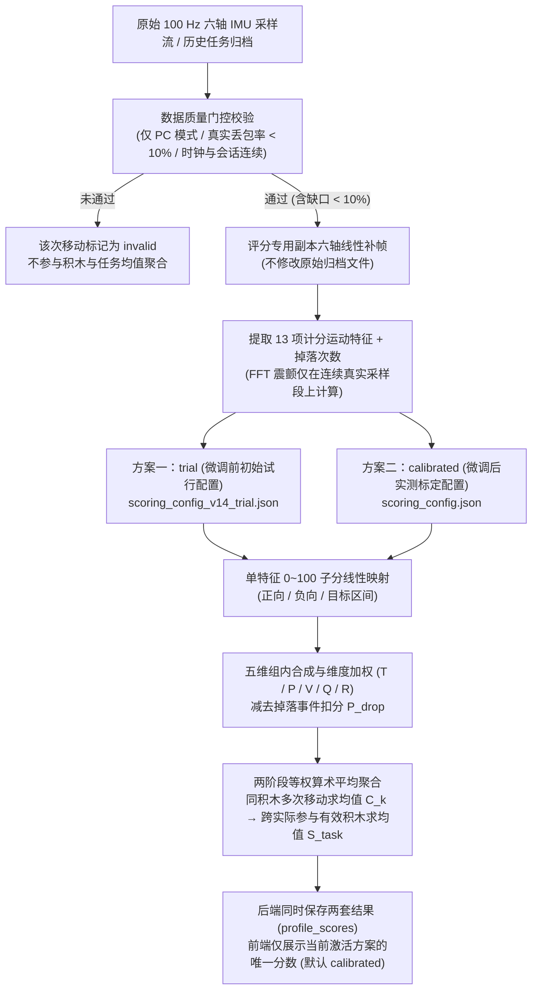

# 智能积木穿墙任务运动表现评分算法说明文档（V1.4 初始试行版 & 云端实测微调版）

本文档完整说明智能积木穿墙任务 V1.4 运动表现评分系统的数学定义、工程门控规则、**微调前（初始试行版 `trial`）的计算方法**，以及**基于云端 31 个实测任务数据完成微调（标定版 `calibrated`）的具体分析与做法**。

---

## 1. 系统架构与双方案运行机制

### 1.1 端到端评分流水线

### 1.2 代码与配置文件对应关系

- **核心评分引擎**：`vue_backend/scoring_engine.py`
- **任务服务与双方案切换**：`vue_backend/task_service.py`、`vue_backend/app.py`
- **离线归档批处理命令行**：`vue_backend/score_task_cli.py`
- **微调前配置（`trial`）**：`vue_backend/defaults/scoring_config_v14_trial.json`（配置版本 `v1.4-provisional-trial`）
- **微调后配置（`calibrated`，当前默认输出）**：`vue_backend/defaults/scoring_config.json`（配置版本 `v1.4-cloud28-p10p95-raw-20261126`）

### 1.3 双方案后台同步计算与切换方式

后端在每次移动结束及每次采集任务结束时，**同时运行微调前（`trial`）与微调后（`calibrated`）两套算法**，将两套完整结果保存在后端 `score_summary.profile_scores` 中；前端界面始终只读取并显示当前激活方案输出的唯一分数（默认激活 `calibrated`）。可通过以下任一方式随时切换：

1. **HTTP 接口实时切换**（毫秒级生效，自动持久化至 `vue_backend/runtime/scoring_profile.json`）：
   - 切换为微调后分数：`POST /api/scoring-config/profile` 请求体 `{"profile": "calibrated"}`
   - 切换为微调前初始试行分：`POST /api/scoring-config/profile` 请求体 `{"profile": "trial"}`
   - 查询当前生效方案：`GET /api/scoring-config`（查看 `active_profile` 字段）
2. **环境变量切换**：启动后端时指定 `MOTION_SCORING_PROFILE=trial` 或 `calibrated`。
3. **离线 CLI 指定方案**：
   - `python vue_backend/score_task_cli.py task_xxx.zip --profile calibrated`
   - `python vue_backend/score_task_cli.py task_xxx.zip --profile trial`

---

## 2. 公共底层计算公式（微调前后共用）

微调前（`trial`）与微调后（`calibrated`）共用完全一致的质量门控、补帧重算、特征提取、子分映射函数与两阶段算术平均聚合公式，**不做任何后置非线性或分段分数拉伸**。

### 2.1 数据质量门控与评分专用补帧

一次移动记录必须同时满足以下条件方可进入计分，否则判定为 `invalid`（返回 `score = null`，绝不用 `0` 代替缺失值）：

1. **分析模式要求**：`analysis_mode == "pc"`（仅上位机完整惯导分析模式参与评分）。
2. **会话连续性**：移动期间未发生设备重连或 `session_id` 跳变。
3. **硬件时钟一致性**：间断边界两端的采样序号差 $\Delta \text{seq}$ 与 32.768 kHz 硬件计时器跨度 $\Delta t_{\text{tick}}$ 满足标称周期 $T_s = 0.01\text{ s}$ 约束：
   $$|\Delta t_{\text{tick}} - 0.01 \cdot \Delta \text{seq}| \le \max(0.03\text{ s},\ 0.02 \cdot \Delta t_{\text{tick}})$$
4. **缺失帧比例门控**：设移动窗口预期总帧数为 $N_{\text{exp}}$，缺失/补帧总数为 $N_{\text{miss}}$，要求：
   $$r_{\text{miss}} = \frac{N_{\text{miss}}}{N_{\text{exp}}} < 10\%$$
   若 $r_{\text{miss}} \ge 10\%$，直接判定 `missing_ratio_exceeded`（无效移动）。
5. **评分专用六轴线性补帧**：当 $0 < r_{\text{miss}} < 10\%$ 时，仅在内存评分副本上对三轴加速度与三轴角速度做两端线性插值（正式采集走 `repaired` 原始流重放路径，旧历史归档走 `repaired_estimate` 边界桥接路径），**绝不修改原始导出的 `detail.json / samples.json / samples.csv`**。
6. **特征有效性校验**：核心速度样本数 `p05_sample_count > 0`；频域震颤特征 `tremor.valid == True`（FFT 仅在剔除补帧点后的连续真实采样段上计算，避免线性插值压低高频能量）。

---

### 2.2 运动特征全集定义

| 维度 | 特征键名 | 物理含义 | 单位 | 计分方向 | 备注 |
| :---: | :--- | :--- | :---: | :---: | :--- |
| **效率 `T`** | `moving_seconds` | 扣除静止停顿后的纯移动耗时 | `s` | 负向（越小越好） | 反映穿孔对准效率 |
| **流畅度 `P`** | `pause_total_seconds` | 移动中途停顿累计时长 | `s` | 负向（越小越好） | 反映动作犹豫程度 |
| **流畅度 `P`** | `pause_count` | 移动中途停顿次数 | 次 | 负向（越小越好） | 反映动作连贯性 |
| **速度 `V`** | `p05` | 剔除首尾缓冲后第 5 百分位速度 | `m/s` | 正向（越大越好） | 反映最低推进速度下限 |
| **速度 `V`** | `max` | 峰值线速度 | `m/s` | 正向（越大越好） | 反映最大推进速率 |
| **速度 `V`** | `mean` | 平均线速度 | `m/s` | 正向（越大越好） | 反映整体推进快慢 |
| **速度 `V`** | `median` | 中位线速度 | `m/s` | 正向（越大越好） | 抗极端值的中心速度 |
| **平稳度 `Q`** | `std` | 线速度标准差 | `m/s` | 负向（越小越好） | 反映速度忽快忽慢波动 |
| **平稳度 `Q`** | `intensity_dps` | 主频附近震颤角速度强度 | `°/s` | 负向（越小越好） | 反映手部窄带生理/动作震颤 |
| **平稳度 `Q`** | `band_rms_dps` | 震颤频带角速度均方根（RMS） | `°/s` | 负向（越小越好） | 反映宽带抖动总能量 |
| **姿态 `R`** | `angle` | 空间累计旋转总角度 | `°` | 负向 或 目标区间 | 视积木穿孔类型而定 |
| **姿态 `R`** | `rotation_count` | 绕单轴整圈旋转次数 | 次 | 负向 或 目标区间 | `J` 多半圆块不启用 |
| **姿态 `R`** | `flip_count` | 大角度翻转次数 | 次 | 负向 或 目标区间 | `G` 螺纹筒与 `J` 块不启用 |
| **事件扣分** | `drop_count` | 积木意外脱手/掉落次数 | 次 | 独立扣分项 | 每次扣 10 分，封顶扣 30 分 |
| *仅记录* | `dominant_frequency_hz` | 震颤主频 | `Hz` | **不计分** | 仅存档供科研分析 |
| *仅记录* | `shake_count` | 剧烈晃动计数 | 次 | **不计分** | 与 `Q` 重复，仅记录不重复扣分 |

---

### 2.3 单特征 0–100 子分映射公式

记截断函数 $\text{clip}_{[0,1]}(z) = \min(1, \max(0, z))$。

1. **正向单调特征**（越大越好，用于速度维度 `V`，参数为下界 $L$ 与上界 $U$，$U > L$）：
   $$s_+(x;\ L, U) = 100 \cdot \text{clip}_{[0,1]}\!\left(\frac{x - L}{U - L}\right)$$
   - 当 $x \le L$ 时得 $0$ 分；当 $x \ge U$ 时得 $100$ 分；区间内线性递增。

2. **负向单调特征**（越小越好，用于 `T`、`P`、`Q` 及非旋转类积木的 `R`，参数为最优下界 $L$ 与容忍上界 $U$，$U > L$）：
   $$s_-(x;\ L, U) = 100 \cdot \text{clip}_{[0,1]}\!\left(\frac{U - x}{U - L}\right)$$
   - 当 $x \le L$ 时得 $100$ 分；当 $x \ge U$ 时得 $0$ 分；区间内线性递减。

3. **目标区间特征**（落在合理旋转/翻滚区间内得满分，不足或过多均线性扣分，用于 `G`、`H`、`J` 的姿态维度 `R`，参数为目标平台 $[a, b]$ 与衰减宽度 $d > 0$）：
   $$s_R(x;\ a, b, d) = 100 \cdot \text{clip}_{[0,1]}\!\left(1 - \frac{\max(a - x,\ 0,\ x - b)}{d}\right)$$
   - 当 $a \le x \le b$ 时得 $100$ 分；偏离区间边界达到或超过 $d$ 时降至 $0$ 分。

---

### 2.4 组内合成、单次移动得分与任务总分聚合

1. **前四维固定组内加权**（若配置中某子指标 `enabled = false`，仅在同一维度内部对其余启用指标按原权重比例归一化，不跨维度挪用权重）：
   - 效率维度：$D_T = s_-(\text{moving\_seconds})$
   - 流畅度维度：$D_P = 0.75 \cdot s_-(\text{pause\_total\_seconds}) + 0.25 \cdot s_-(\text{pause\_count})$
   - 速度维度：$D_V = 0.15 \cdot s_+(p_{05}) + 0.10 \cdot s_+(\max) + 0.35 \cdot s_+(\text{mean}) + 0.40 \cdot s_+(\text{median})$
   - 平稳度维度：$D_Q = 0.40 \cdot s_-(\text{std}) + 0.36 \cdot s_-(\text{intensity\_dps}) + 0.24 \cdot s_-(\text{band\_rms\_dps})$

2. **姿态维度 $D_R$ 按积木动作类别合成**：
   - **三视图定位（`A~F`）与平移（`I`）**：$D_R = 0.60 \cdot s_-(\text{angle}) + 0.20 \cdot s_-(\text{rotation\_count}) + 0.20 \cdot s_-(\text{flip\_count})$
   - **旋转（`G` 螺纹筒）**：$D_R = 0.60 \cdot s_R(\text{angle}) + 0.40 \cdot s_R(\text{rotation\_count})$
   - **翻滚（`H` 弧槽块）**：$D_R = 0.80 \cdot s_R(\text{angle}) + 0.20 \cdot s_R(\text{flip\_count})$
   - **多向旋转（`J` 多半圆块）**：$D_R = 1.00 \cdot s_R(\text{angle})$

3. **单次移动得分 $S$**：
   $$B = w_T D_T + w_P D_P + w_V D_V + w_Q D_Q + w_R D_R \quad \left(\sum_{d} w_d = 1\right)$$
   $$P_{\text{drop}} = \min(30,\ 10 \times \text{drop\_count})$$
   $$S = \max(0,\ B - P_{\text{drop}})$$

4. **两阶段等权任务总分聚合（纯算术平均，无后置拉伸）**：
   - **第一阶段（积木得分 $C_k$）**：对积木 $k \in \{\text{A},\dots,\text{J}\}$ 在本任务内的全部 $n_k$ 次有效移动求等权算术平均：
     $$C_k = \frac{1}{n_k} \sum_{j=1}^{n_k} S_{k,j}$$
   - **第二阶段（任务总分 $S_{\text{task}}$）**：对本任务中**实际发生移动且至少有 1 次有效移动**的积木集合 $K_{\text{valid}}$ 求等权算术平均（未触碰的积木记入 `unmoved_blocks`，不计 0 分）：
     $$S_{\text{task}} = \frac{1}{|K_{\text{valid}}|} \sum_{k \in K_{\text{valid}}} C_k$$
   - 展示分四舍五入保留两位小数：`total_score = round(S_task, 2)`。

---

## 3. 微调前怎么算的（`trial`：V1.4 初始试行版）

微调前方案对应 `vue_backend/defaults/scoring_config_v14_trial.json`，直接采用算法设计初期的先验五维权重与人工经验估算区间。

### 3.1 微调前的五维权重配置（`v1.3-prior`）

| 积木类别 | 包含积木 | `w_T` (效率) | `w_P` (流畅度) | `w_V` (速度) | `w_Q` (平稳度) | `w_R` (姿态) |
| :--- | :---: | :---: | :---: | :---: | :---: | :---: |
| **三视图定位** | `A, B, C, D, E, F` | `0.15` | `0.25` | **`0.20`** | `0.25` | `0.15` |
| **纯平移** | `I` (阶梯块) | `0.20` | `0.20` | **`0.25`** | `0.25` | `0.10` |
| **旋转 / 翻滚 / 多向旋转** | `G, H, J` | `0.15` | `0.20` | **`0.15`** | `0.20` | `0.30` |

### 3.2 微调前的十块积木参数表（人工先验试行值）

在收集实测数据前，`A~F` 共用同一套先验阈值，`J` 暂借用 `G` 的连续参数，`H` 暂采用旋转/翻滚估算区间：

| 特征项 | `A ~ F` (三视图块) | `I` (阶梯块) | `G` (螺纹筒) | `H` (弧槽块·暂借) | `J` (多半圆块·借G) |
| :--- | :---: | :---: | :---: | :---: | :---: |
| `moving_seconds` (s) | `[2.0, 12.0]` | `[1.0, 8.0]` | `[10.0, 45.0]` | `[4.0, 30.0]` | `[10.0, 45.0]` |
| `pause_total_seconds` (s) | `[0.0, 12.0]` | `[0.0, 12.0]` | `[0.0, 25.0]` | `[0.0, 25.0]` | `[0.0, 25.0]` |
| `pause_count` (次) | `[0.0, 8.0]` | `[0.0, 8.0]` | `[0.0, 15.0]` | `[0.0, 15.0]` | `[0.0, 15.0]` |
| `p05` (m/s) | `[0.00, 0.05]` | `[0.00, 0.05]` | `[0.02, 0.25]` | `[0.02, 0.25]` | `[0.02, 0.25]` |
| `max` (m/s) | `[0.05, 0.40]` | `[0.05, 0.40]` | `[0.30, 3.00]` | `[0.15, 2.00]` | `[0.30, 3.00]` |
| `mean` (m/s) | `[0.02, 0.15]` | `[0.02, 0.15]` | `[0.10, 1.50]` | `[0.05, 1.00]` | `[0.10, 1.50]` |
| `median` (m/s) | `[0.02, 0.15]` | `[0.02, 0.15]` | `[0.10, 1.50]` | `[0.05, 1.00]` | `[0.10, 1.50]` |
| `std` (m/s) | `[0.02, 0.15]` | `[0.02, 0.15]` | `[0.10, 1.20]` | `[0.05, 0.80]` | `[0.10, 1.20]` |
| `intensity_dps` (°/s) | `[2.0, 20.0]` | `[2.0, 20.0]` | `[5.0, 25.0]` | `[5.0, 25.0]` | `[5.0, 25.0]` |
| `band_rms_dps` (°/s) | `[5.0, 30.0]` | `[5.0, 30.0]` | `[10.0, 70.0]` | `[10.0, 70.0]` | `[10.0, 70.0]` |
| `angle` (°) | `[90.0, 360.0]` | `[20.0, 120.0]` | `[1800, 3000, 1800]` | `[180, 900, 360]` | `[1800, 3000, 1800]` |
| `rotation_count` (次) | `[0.0, 2.0]` | `[0.0, 2.0]` | `[2.0, 5.0, 3.0]` | — | — |
| `flip_count` (次) | `[0.0, 2.0]` | `[0.0, 2.0]` | — | `[1.0, 4.0, 2.0]` | — |

### 3.3 微调前手算验证示例（螺纹筒 `G`）

假设一次螺纹筒（`G`）有效移动提取到的五维得分分别为 $D_T = 80$、$D_P = 90$、$D_V = 75$、$D_Q = 85$、$D_R = 92$：
- 基础分：$B = 0.15 \times 80 + 0.20 \times 90 + 0.15 \times 75 + 0.20 \times 85 + 0.30 \times 92 = 12 + 18 + 11.25 + 17 + 27.6 = 85.85$
- 若无掉落（`drop_count = 0`）：单次移动得分 $S = 85.85$
- 若掉落 1 次（`drop_count = 1`）：$S = \max(0, 85.85 - 10) = 75.85$

在云端基准任务 `T20261110-110733-75AE`（共参与 6 块积木）上，微调前各积木得分为 `A: 48.35, B: 70.76, D: 66.36, G: 64.07, I: 50.70, J: 61.59`，算术均值总分为 **`60.31`**。

---

## 4. 微调后怎么做的（`calibrated`：基于云端实测数据标定）

微调后方案对应 `vue_backend/defaults/scoring_config.json`，基于云端收集的全部 **31 个历史任务归档（457.42 MB）** 实测分布完成标定。

### 4.1 实测数据集整理与质量清洗

1. **任务与移动段规模**：31 个云端任务中包含 **28 个非空有效任务**与 **3 个 0 移动空任务**；共提取 **454 段** PC 移动，其中 **443 段（97.6%）** 通过 10% 丢包与 FFT 有效性门控（仅 9 段因真实丢包 `12.39% ~ 65.67%` 剔除，2 段因去插值后连续真实窗口过短剔除）。
2. **十块积木样本覆盖度**：每块积木均具备充足的独立受试任务（`A: 22, B: 21, C: 19, D: 23, E: 23, F: 23, G: 19, H: 19, I: 17, J: 18`），使得原本无参数的 `H`（弧槽块）和 `J`（多半圆块）也得以独立实测标定。
3. **历史归档边界修复**：针对旧归档 `samples.json` 省略 ZUPT 静止确认帧以及移动结束 3.0 s 静止保持窗内的 0 丢包 `host_arrival_gap` 记录，完善了 `repair_legacy_archive_movement` 边界匹配逻辑，确保历史数据无误判。

---

### 4.2 实测数据暴露出的三大问题（为什么要微调）

将 443 段真实移动代入微调前（`trial`）配置后，统计发现三处显著失配：

1. **初始人工估算区间与真实穿孔操作严重不符（大量触底 0 分）**
   - **阶梯块 `I`**：试行配置设 `moving_seconds = [1, 8] s`、`angle = [20, 120]°`，而实测受试者对准阶梯孔的 95% 耗时达 `44.06 s`，手部微调累计转角中位数超过 `300°`，导致试行版近半数正常操作在 `T` 和 `R` 上直接得 `0` 分，`I` 块均分被压低至仅 **`45.67`**。
   - **旋转/翻滚块 `G / H / J`**：试行配置要求平移速度达 `1.0 ~ 1.5 m/s` 才拿满分，但原地拧螺纹筒或翻滚弧槽块时线速度天然很小（实测中位速度普遍在 `0.03 ~ 0.5 m/s`），导致 `V` 维度均分塌缩至 `25` 分左右。
   - **三视图块 `A ~ F` 难度差异被掩盖**：例如四翼块 `E`、十字块 `C` 的对准耗时和调整转角明显大于圆柱块 `A`，共用 `[2, 12] s` 和 `[90, 360]°` 导致复杂积木系统性吃亏。

2. **纯惯导积分速度 `V` 与效率 `T`、平稳度 `Q` 发生强反向抵消**
   - 对 443 段实测移动计算五维子分相关矩阵发现：
     $$\text{Corr}(D_T,\ D_V) = -0.85, \qquad \text{Corr}(D_V,\ D_Q) = -0.74, \qquad \text{Corr}(D_V,\ D_R) = -0.67$$
   - **物理原因**：在没有外部光学/UWB 位置锚点的纯六轴 IMU 模式下，线速度由去重力加速度一次积分得到。移动耗时越长（动作越慢、越卡壳，$D_T \to 0$），加速度计微小零偏累积出的漂移速度反而越大（$D_V \to 100$）；反之，2.5 秒干净利落穿孔的优秀动作（$D_T, D_Q, D_R > 90$），因积分时间极短，估计速度很小（$D_V \approx 10$）。
   - **后果**：微调前 `V` 占据 `15% ~ 25%` 的高权重，等于给慢动作白送近 20 分、给快动作倒扣近 20 分，把所有人的任务总分死死挤压在 **`47.18 ~ 61.64`** 的窄带内。

3. **超长移动段的惯导积分漂移离群值**
   - 个别耗时 30～60 秒的移动段出现明显速度积分发散（`mean > 1.2 m/s` 或 `max > 3.0 m/s`），若不剔除会直接拉偏速度参数上界 $U$。

---

### 4.3 微调的具体做法（五步标定法）

遵循 V1.4 规范第 08 节经验标定原则，按以下五步生成 `scoring_config.json`：

#### 第一步：任务内同积木等权抽样
若受试者在任务 $t$ 中对积木 $k$ 产生了 $n_{t,k}$ 次有效移动，则每次移动在分位数统计中赋予权重：
$$w_{t,k,j} = \frac{1}{n_{t,k}}$$
确保每位受试者对该积木参数分布的总贡献恒为 `1.0`，避免单次任务内反复试错十几次的样本主导群体阈值。

#### 第二步：惯导速度漂移离群筛查
在统计速度相关特征（`p05 / max / mean / median / std`）的分位数前，筛除满足 `mean > 1.2 m/s` 或 `max > 3.0 m/s` 的长时积分漂移样本（仅影响标定拟合过程，实际评分时所有有效移动正常计分）。

#### 第三步：按实测加权分位数独立标定 `A ~ J` 十块积木参数
- **负向连续指标（`moving_seconds`、`std`、`intensity_dps`、`band_rms_dps`）**：取各积木实测加权分位数 **`[P10, P95]`** 作为 `[L, U]`（前 10% 优秀表现拿满分 `100`，容忍上界放至 `P95` 使极端触底 `0` 分比例控制在 5% 左右）。
- **停顿指标（`pause_total_seconds`、`pause_count`）**：最优下界固定 **`L = 0`**（全程无停顿得满分），容忍上界取实测 **`P95`**（设合理下限保底）。
- **正向速度指标（`p05`、`max`、`mean`、`median`）**：取筛除漂移后的实测加权分位数 **`[P10, P90]`** 作为 `[L, U]`。
- **姿态指标（`R`）**：
  - **三视图与平移积木（`A ~ F, I`）**：`angle` 下界取实测 `P25`（对正常手持对准留出合理免扣分角度，封顶 `240°`），上界取实测 `P95`；离散误转/误翻计数保持 `[0, 2]`。
  - **旋转 / 翻滚 / 多向旋转积木（`G, H, J`）**：基于各自实测旋转角与圈数分布设定目标平台 `[a, b]` 与衰减宽度 `d`（如 `G` 取 `[300°, 3860.2°, 2670.1°]`，`H` 取 `[180°, 1953.5°, 1330.1°]`，`J` 取 `[270°, 3853.9°, 2687.9°]`；因当前尚无人工穿孔成败标签，保留 `provisional: true` 标记）。

#### 第四步：下调纯惯导速度维度权重（消除反向抵消）
在保留速度特征完整性校验的前提下，将各积木 `V` 维度权重统一降至 **`0.05`**，释放出的权重按原比例分配给反映真实操作质量的 `T`（效率）、`P`（流畅度）、`Q`（平稳度）和 `R`（姿态）：

| 积木类别 | 包含积木 | 方案版本 | `w_T` | `w_P` | `w_V` | `w_Q` | `w_R` |
| :--- | :---: | :---: | :---: | :---: | :---: | :---: | :---: |
| **三视图定位** | `A ~ F` | 微调前 → **微调后** | `0.15` → **`0.20`** | `0.25` → **`0.28`** | `0.20` → **`0.05`** | `0.25` → **`0.29`** | `0.15` → **`0.18`** |
| **纯平移** | `I` | 微调前 → **微调后** | `0.20` → **`0.25`** | `0.20` → **`0.25`** | `0.25` → **`0.05`** | `0.25` → **`0.30`** | `0.10` → **`0.15`** |
| **旋转 / 翻滚 / 多向旋转** | `G, H, J` | 微调前 → **微调后** | `0.15` → **`0.18`** | `0.20` → **`0.22`** | `0.15` → **`0.05`** | `0.20` → **`0.23`** | `0.30` → **`0.32`** |

#### 第五步：保持纯算术平均聚合（不做后置拉伸）
删除任何单次移动或任务总分的后置分段拉伸函数，任务总分严格等于各参与有效积木得分的直接算术平均，保证每一分都可由底层物理特征线性溯源。

---

### 4.4 微调后的十块积木完整参数表（`v1.4-cloud28-p10p95-raw-20261126`）

#### （1）三视图定位与平移积木（`A ~ F, I`）

| 特征项 | `A` 圆柱块 | `B` 四面尖块 | `C` 十字块 | `D` 扇锥块 | `E` 四翼块 | `F` 弧翼块 | `I` 阶梯块 |
| :--- | :---: | :---: | :---: | :---: | :---: | :---: | :---: |
| `moving_seconds` | `[2.45, 18.86]` | `[2.19, 23.30]` | `[2.63, 42.76]` | `[2.48, 36.21]` | `[2.34, 41.86]` | `[2.53, 39.14]` | `[2.79, 44.06]` |
| `pause_total_seconds` | `[0.0, 22.36]` | `[0.0, 17.20]` | `[0.0, 20.05]` | `[0.0, 14.20]` | `[0.0, 18.50]` | `[0.0, 12.00]` | `[0.0, 27.52]` |
| `pause_count` | `[0.0, 16.0]` | `[0.0, 11.0]` | `[0.0, 14.0]` | `[0.0, 10.0]` | `[0.0, 12.0]` | `[0.0, 7.0]` | `[0.0, 16.0]` |
| `p05` | `[0.009, 0.102]` | `[0.008, 0.151]` | `[0.011, 0.096]` | `[0.007, 0.149]` | `[0.014, 0.164]` | `[0.007, 0.136]` | `[0.008, 0.094]` |
| `max` | `[0.090, 1.171]` | `[0.077, 1.679]` | `[0.088, 1.345]` | `[0.059, 1.403]` | `[0.157, 1.673]` | `[0.087, 1.829]` | `[0.096, 2.258]` |
| `mean` | `[0.026, 0.375]` | `[0.029, 0.687]` | `[0.034, 0.630]` | `[0.023, 0.546]` | `[0.042, 0.694]` | `[0.028, 0.851]` | `[0.037, 1.035]` |
| `median` | `[0.028, 0.316]` | `[0.022, 0.604]` | `[0.031, 0.607]` | `[0.020, 0.512]` | `[0.037, 0.516]` | `[0.025, 0.823]` | `[0.029, 1.162]` |
| `std` | `[0.011, 0.307]` | `[0.014, 0.437]` | `[0.018, 0.391]` | `[0.012, 0.473]` | `[0.025, 0.453]` | `[0.016, 0.721]` | `[0.021, 0.751]` |
| `intensity_dps` | `[2.83, 23.17]` | `[3.84, 30.98]` | `[3.94, 23.53]` | `[6.09, 20.61]` | `[5.02, 54.95]` | `[4.74, 24.76]` | `[3.16, 21.70]` |
| `band_rms_dps` | `[6.94, 44.33]` | `[6.38, 49.34]` | `[9.32, 43.77]` | `[8.74, 51.10]` | `[12.19, 58.55]` | `[7.72, 49.70]` | `[5.73, 42.89]` |
| `angle` (`[L, U]`) | `[66.5, 1573.8]` | `[70.6, 1722.0]` | `[57.2, 1826.2]` | `[71.7, 1916.4]` | `[144.9, 2483.6]` | `[144.2, 2941.1]` | `[44.3, 2091.4]` |
| `rotation_count` | `[0.0, 2.0]` | `[0.0, 2.0]` | `[0.0, 2.0]` | `[0.0, 2.0]` | `[0.0, 2.0]` | `[0.0, 2.0]` | `[0.0, 2.0]` |
| `flip_count` | `[0.0, 2.0]` | `[0.0, 2.0]` | `[0.0, 2.0]` | `[0.0, 2.0]` | `[0.0, 2.0]` | `[0.0, 2.0]` | `[0.0, 2.0]` |

#### （2）旋转、翻滚与多向旋转积木（`G, H, J`）

| 特征项 | `G` 螺纹筒（旋转） | `H` 弧槽块（翻滚） | `J` 多半圆块（多向旋转） |
| :--- | :---: | :---: | :---: |
| `moving_seconds` | `[2.72, 97.82]` | `[2.22, 39.85]` | `[2.56, 69.70]` |
| `pause_total_seconds` | `[0.0, 15.88]` | `[0.0, 19.44]` | `[0.0, 18.87]` |
| `pause_count` | `[0.0, 11.0]` | `[0.0, 12.0]` | `[0.0, 12.0]` |
| `p05` | `[0.005, 0.095]` | `[0.010, 0.089]` | `[0.008, 0.060]` |
| `max` | `[0.091, 1.830]` | `[0.096, 1.343]` | `[0.070, 1.411]` |
| `mean` | `[0.038, 0.817]` | `[0.037, 0.513]` | `[0.024, 0.436]` |
| `median` | `[0.029, 0.703]` | `[0.032, 0.529]` | `[0.022, 0.311]` |
| `std` | `[0.021, 0.576]` | `[0.019, 0.306]` | `[0.013, 0.516]` |
| `intensity_dps` | `[3.34, 28.62]` | `[3.83, 50.37]` | `[4.71, 25.90]` |
| `band_rms_dps` | `[6.55, 55.83]` | `[9.14, 62.40]` | `[13.16, 46.31]` |
| `angle` (`[a, b, d]`) | `[300.0, 3860.2, 2670.1]` | `[180.0, 1953.5, 1330.1]` | `[270.0, 3853.9, 2687.9]` |
| `rotation_count` (`[a, b, d]`) | `[1.0, 4.0, 2.0]` | — | — |
| `flip_count` (`[a, b, d]`) | — | `[1.0, 2.0, 2.0]` | — |

---

## 5. 微调前后实测效果对比（云端 28 个非空任务）

### 5.1 整体任务分统计对比

| 统计指标 | 微调前（`trial` 初始试行版） | **微调后（`calibrated` 实测标定版）** | 变化说明 |
| :--- | :---: | :---: | :--- |
| **最大值** | `61.64` | **`83.61`** | `+21.97`，优秀表现不再被速度项反扣封死 |
| **最小值** | `47.18` | **`57.22`** | `+10.04`，消除正常耗时触底 0 分的系统性压分 |
| **中位数** | `55.70` | **`71.44`** | `+15.74`，回归日常直观的 70 分中心水位 |
| **平均值** | `55.20` | **`69.67`** | `+14.47` |
| **分数跨度（极差）** | `14.46` | **`26.39`** | 区分跨度扩大 **82.5%** |

### 5.2 十块积木各自平均分对比

| 积木 | A 圆柱块 | B 四面尖块 | C 十字块 | D 扇锥块 | E 四翼块 | F 弧翼块 | G 螺纹筒 | H 弧槽块 | I 阶梯块 | J 多半圆块 |
| :--- | :---: | :---: | :---: | :---: | :---: | :---: | :---: | :---: | :---: | :---: |
| **微调前均分 (`trial`)** | `57.20` | `59.29` | `55.66` | `54.37` | `52.34` | `53.88` | `58.10` | `59.86` | `45.67` | `52.17` |
| **微调后均分 (`calibrated`)** | **`69.05`** | **`71.11`** | **`70.28`** | **`66.35`** | **`68.49`** | **`67.77`** | **`70.07`** | **`72.37`** | **`63.59`** | **`72.07`** |

---

## 6. 后续演进说明

1. **补充外部效度标签后升级权重**：当前微调严格基于无标签运动学分布完成；待后续采集临床认知/手功能量表（如 MoCA、九孔插板耗时）或人工穿孔成功/失败标注后，可在保持框架不变的前提下，用带正则回归校准五维权重，并将 `G / H / J` 的目标区间从 `provisional: true` 升级为监督标定区间。
2. **分孔位精细化覆写**：配置文件已预留 `hole_overrides`（键格式如 `"C:十字孔"`），后续若在任务协议中记录每次穿入的具体孔位编号，可直接按孔位启用差异化参数而不必改动评分引擎代码。
